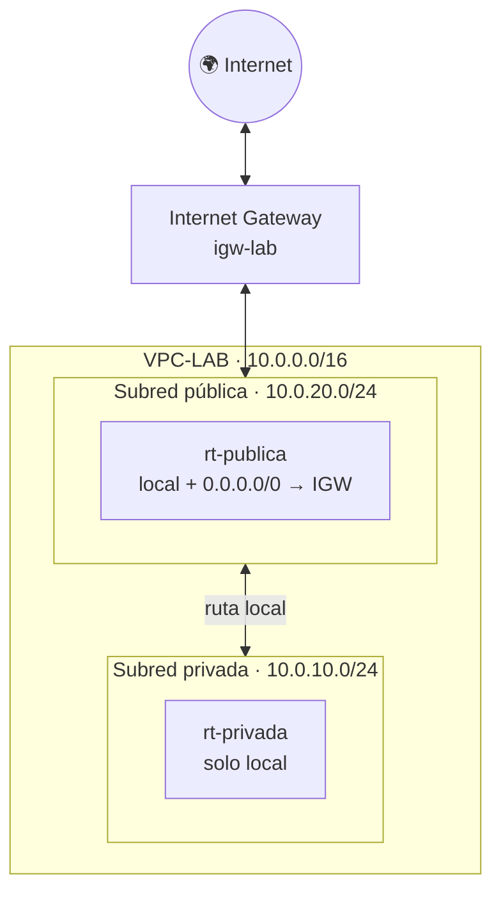

# 🌐 VPC con subred pública y subred privada en AWS

Guía técnica para crear una red virtual (VPC) en AWS con dos subredes:

- 🟢 **Subred pública:** tiene salida a Internet. Aquí van servidores web, bastiones o balanceadores.
- 🔒 **Subred privada:** no tiene salida a Internet. Aquí van bases de datos y servicios internos.

Todo se configura desde la consola web de AWS, sin asistentes automáticos, para que se entienda cada componente.

---

## 📐 Arquitectura

| Recurso | Nombre | Valor |
|---|---|---|
| VPC | `VPC-LAB` | `10.0.0.0/16` |
| Subred pública | `subnet-publica` | `10.0.20.0/24` · `us-east-1a` |
| Subred privada | `subnet-privada` | `10.0.10.0/24` · `us-east-1a` |
| Internet Gateway | `igw-lab` | conectado a `VPC-LAB` |
| Tabla de rutas pública | `rt-publica` | `local` + `0.0.0.0/0 → igw-lab` |
| Tabla de rutas privada | `rt-privada` | solo `local` |

> 💡 Los nombres y rangos son de ejemplo y se pueden adaptar. La única regla es que las subredes queden **dentro** del CIDR de la VPC y no se superpongan entre sí.

---

## 🧱 Conceptos clave

| Componente | Qué es |
|---|---|
| **VPC** | Red virtual aislada dentro de AWS. Define un rango de direcciones privadas propio (CIDR). |
| **CIDR** | Notación del rango de IPs. `/16` = 65.536 direcciones; `/24` = 256 direcciones (AWS reserva 5 por subred). |
| **Subred** | División de la VPC asociada a una zona de disponibilidad. Las instancias se lanzan dentro de una subred. |
| **Zona de disponibilidad (AZ)** | Centro de datos físico dentro de una región (`us-east-1a`, `us-east-1b`, etc.). |
| **Internet Gateway (IGW)** | Puerta de enlace que conecta la VPC con Internet. Sin él, nada en la VPC sale ni entra desde Internet. |
| **Tabla de rutas** | Define hacia dónde se envía el tráfico de una subred. Determina si una subred es pública o privada. |
| **Ruta `local`** | Ruta automática que comunica todas las subredes de la VPC entre sí. No se puede eliminar. |

> 📌 Una subred **no es pública por su nombre**, sino por su tabla de rutas: es pública si tiene una ruta `0.0.0.0/0` hacia un Internet Gateway.

---

## 1️⃣ Crear la VPC

**Ruta:** VPC → Sus VPC → **Crear VPC**

| Campo | Valor | Explicación |
|---|---|---|
| Recursos que se van a crear | Solo la VPC | Crea únicamente la VPC; el resto se configura manualmente. |
| Etiqueta de nombre | `VPC-LAB` | Nombre identificador (crea la etiqueta `Name`). |
| Bloque de CIDR IPv4 | Entrada manual | Se define el rango a mano. |
| CIDR IPv4 | `10.0.0.0/16` | Espacio total de direcciones de la VPC. |
| Bloque de CIDR IPv6 | Sin bloque | No se usa IPv6 en este diseño. |
| Tenencia | Predeterminado | Hardware compartido. "Dedicado" tiene costo adicional. |
| Control de cifrado de VPC | Ninguno | Los modos de supervisión u obligatorio tienen costo adicional. |

👉 **Crear VPC**

### ⚙️ Habilitar DNS

**Ruta:** seleccionar la VPC → Acciones → **Editar configuración de VPC**

| Opción | Valor | Explicación |
|---|---|---|
| Habilitar la resolución de DNS | ✅ | Permite que las instancias resuelvan nombres usando el DNS de AWS. |
| Habilitar nombres de host DNS | ✅ | Asigna nombres DNS a las instancias con IP pública. |
| Métricas de uso de direcciones de red | ⬜ | No es necesario. |

👉 **Guardar**

> ⚠️ Si la VPC se crea con un CIDR pequeño (por ejemplo `/24`), no es posible crear dos subredes `/24`. Si ocurre, elimine la VPC vacía y créela de nuevo con `/16`.

---

## 2️⃣ Crear las subredes

**Ruta:** VPC → Subredes → **Crear subred** → ID de la VPC: `VPC-LAB`

### Subred pública

| Campo | Valor | Explicación |
|---|---|---|
| Nombre | `subnet-publica` | Identificador de la subred. |
| Zona de disponibilidad | `us-east-1a` | AZ donde vivirá la subred. |
| Bloque de CIDR de VPC | `10.0.0.0/16` | Rango de la VPC del que se toma la subred. |
| Bloque de CIDR de la subred | `10.0.20.0/24` | 256 direcciones para esta subred. |

👉 **Agregar nueva subred**

### Subred privada

| Campo | Valor |
|---|---|
| Nombre | `subnet-privada` |
| Zona de disponibilidad | `us-east-1a` |
| Bloque de CIDR de VPC | `10.0.0.0/16` |
| Bloque de CIDR de la subred | `10.0.10.0/24` |

👉 **Crear subred**

> 💡 Si se deja "Sin preferencia" en la zona, AWS puede asignar AZ distintas a cada subred. Conviene fijarla.

### 🟢 Asignación automática de IP pública

**Ruta:** seleccionar `subnet-publica` → Acciones → **Editar la configuración de la subred**

| Opción | Valor | Explicación |
|---|---|---|
| Asignación automática de dirección IPv4 pública | ✅ | Toda instancia lanzada aquí recibe una IP pública. |
| Tipo de nombre de alojamiento | Nombre de IP | El hostname interno se basa en la IP privada. |
| Registros DNS A / AAAA y DNS64 | ⬜ | No se requieren. |

👉 **Guardar**

🔒 En `subnet-privada` esta opción se deja **deshabilitada** (valor por defecto): sus instancias no tendrán IP pública.

---

## 3️⃣ Crear el Internet Gateway

**Ruta:** VPC → Puertas de enlace de Internet → **Crear gateway de Internet**

| Campo | Valor |
|---|---|
| Etiqueta de nombre | `igw-lab` |

👉 **Crear gateway de Internet**

Al crearse queda en estado `Detached` (sin conectar).

**Ruta:** Acciones → **Conectar a la VPC** → `VPC-LAB` → **Conectar gateway de Internet**

✅ Estado esperado: **Attached**

> 📌 Una VPC solo puede tener **un** Internet Gateway conectado.

---

## 4️⃣ Tabla de rutas pública

**Ruta:** VPC → Tablas de enrutamiento → **Crear tabla de enrutamiento**

| Campo | Valor |
|---|---|
| Nombre | `rt-publica` |
| VPC | `VPC-LAB` |

👉 **Crear tabla de enrutamiento**

### Agregar la ruta a Internet

**Ruta:** pestaña **Rutas** → Editar rutas → **Agregar ruta**

| Destino | Objetivo | Explicación |
|---|---|---|
| `10.0.0.0/16` | local | Ya existe. Comunicación interna de la VPC. |
| `0.0.0.0/0` | Puerta de enlace de Internet → `igw-lab` | Todo tráfico que no sea interno sale por el IGW. |

👉 **Guardar cambios**

> ⚠️ Elegir **Puerta de enlace de Internet**, no "Gateway de Internet de solo salida", que es solo para IPv6.

### Asociar la subred

**Ruta:** pestaña **Asociaciones de subredes** → Editar asociaciones de subredes → marcar `subnet-publica` → **Guardar asociaciones**

---

## 5️⃣ Tabla de rutas privada

**Ruta:** VPC → Tablas de enrutamiento → **Crear tabla de enrutamiento**

| Campo | Valor |
|---|---|
| Nombre | `rt-privada` |
| VPC | `VPC-LAB` |

👉 **Crear tabla de enrutamiento**

**Rutas:** no se agrega nada. Queda solo:

| Destino | Objetivo |
|---|---|
| `10.0.0.0/16` | local |

🔒 Al no existir una ruta `0.0.0.0/0`, la subred no tiene salida a Internet.

### Asociar la subred

**Ruta:** pestaña **Asociaciones de subredes** → Editar asociaciones de subredes → marcar `subnet-privada` → **Guardar asociaciones**

> 💡 AWS crea una **tabla principal** junto con la VPC. Las subredes sin asociación explícita la usan por defecto. Es buena práctica asociar cada subred a su propia tabla y dejar la principal sin uso.

---

## ✅ Verificación

**Ruta:** VPC → Sus VPC → `VPC-LAB` → pestaña **Mapa de recursos** → *Mostrar todos los detalles*

| Elemento | Estado esperado |
|---|---|
| Subredes | `subnet-publica` y `subnet-privada` en `us-east-1a` |
| Tablas de enrutamiento | `rt-publica`, `rt-privada` y la principal |
| `subnet-publica` | asociada a `rt-publica` → conectada a `igw-lab` |
| `subnet-privada` | asociada a `rt-privada` → sin conexión externa |
| Conexiones de red | `igw-lab` |

### 🧪 Pruebas con instancias

| Prueba | Desde | Resultado esperado |
|---|---|---|
| `ping -c 3 8.8.8.8` | instancia en subred pública | ✅ responde |
| `ping -c 3 8.8.8.8` | instancia en subred privada | ❌ falla |
| `curl -m 5 https://aws.amazon.com` | instancia en subred privada | ❌ timeout |
| Conexión a IP privada de la otra subred | cualquiera | ✅ si el Security Group lo permite |

---

## 📦 Instalar paquetes en la subred privada

La subred privada no tiene salida, así que una instancia lanzada ahí no puede ejecutar `apt` ni `yum`. Hay dos alternativas:

**Opción A: AMI personalizada (sin costo adicional)**
1. Lanzar una instancia temporal en la subred pública e instalar los paquetes.
2. EC2 → Acciones → Imagen y plantillas → **Crear imagen**.
3. Lanzar la instancia definitiva desde esa AMI en la subred privada, sin IP pública.
4. Terminar la instancia temporal.

**Opción B: NAT Gateway temporal (con costo por hora)**
1. Crear un NAT Gateway en la subred pública con una IP elástica.
2. En `rt-privada`, agregar `0.0.0.0/0 → NAT Gateway`.
3. Instalar los paquetes.
4. Eliminar la ruta, eliminar el NAT Gateway y liberar la IP elástica.

> 📌 Una instancia no se puede mover de subred después de creada. Para cambiarla de subred hay que recrearla, por ejemplo desde una AMI.

---

## 🛠️ Errores comunes

| Problema | Causa | Solución |
|---|---|---|
| "CIDR no válido" al crear subred | El rango no está dentro del CIDR de la VPC | Usar un rango contenido en la VPC o recrearla con `/16` |
| Error al crear un recurso con etiquetas | Fila de etiqueta con clave vacía | Quitar la fila vacía |
| La instancia pública no tiene IP pública | Asignación automática deshabilitada | Habilitarla en la subred o al lanzar la instancia |
| La instancia pública no sale a Internet | Falta la ruta `0.0.0.0/0` o la asociación de subred | Revisar `rt-publica` |
| La subred privada sale a Internet | Está usando una tabla con ruta al IGW o al NAT | Revisar asociación y rutas de `rt-privada` |
| No aparece el IGW como objetivo | El IGW no está conectado a la VPC | Acciones → Conectar a la VPC |

---

## 🧹 Limpieza

Para eliminar el laboratorio sin dejar recursos con costo, se borra en este orden:

1. Instancias EC2 de la VPC.
2. NAT Gateway e IPs elásticas, si se usaron.
3. **Sus VPC → `VPC-LAB` → Acciones → Eliminar VPC**. Este paso elimina también las subredes, las tablas de rutas y desconecta el IGW.
